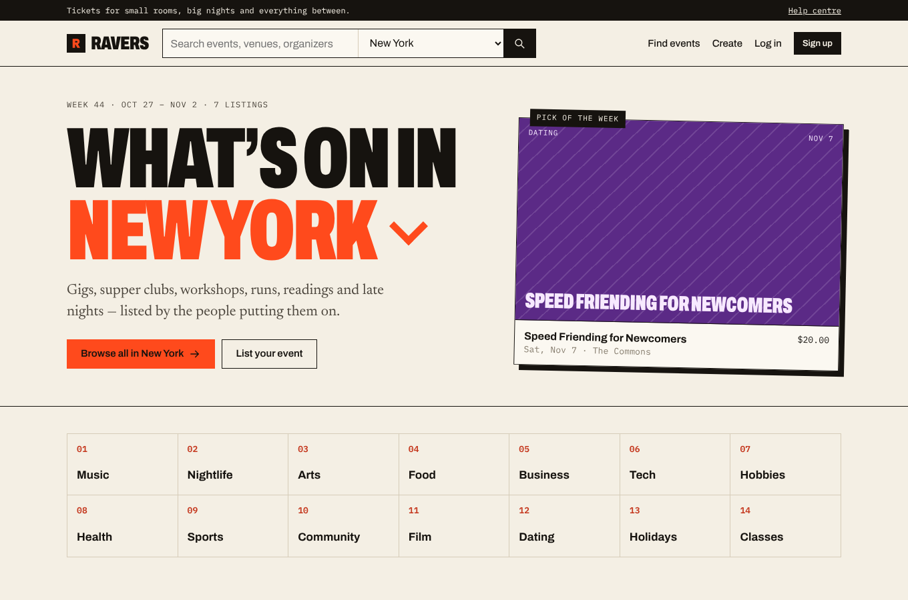
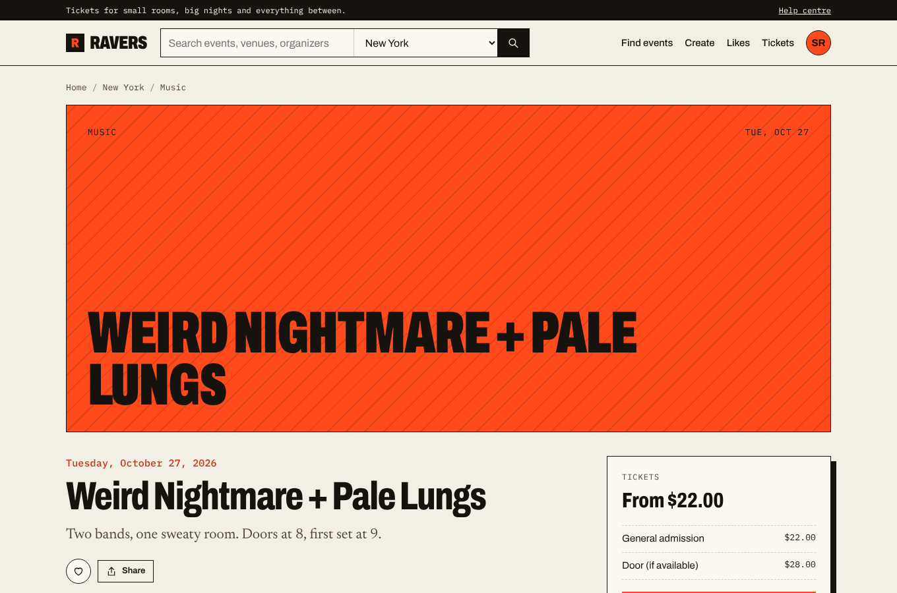
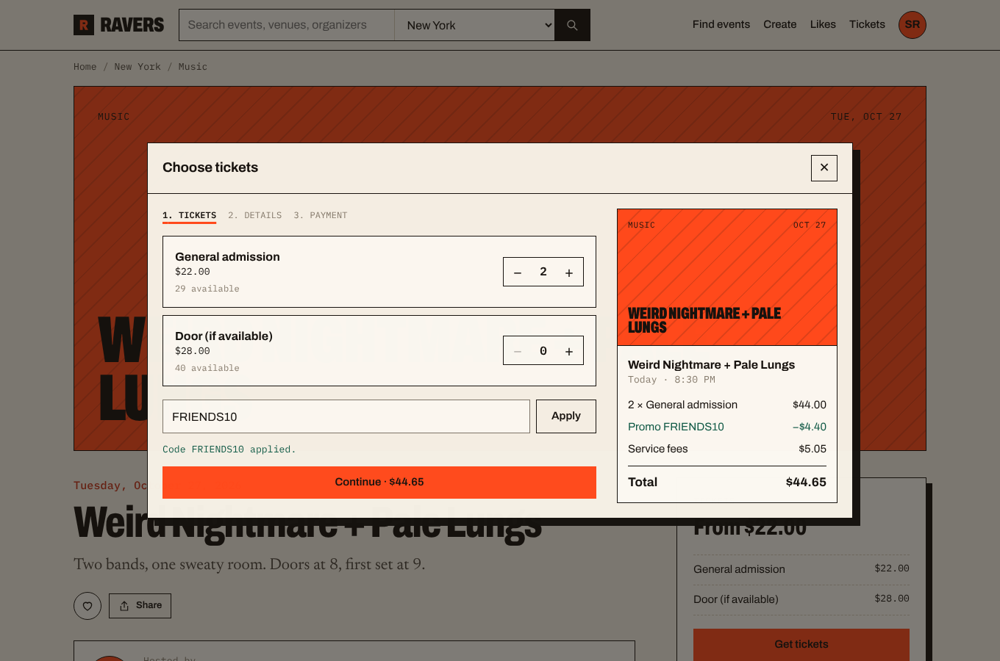
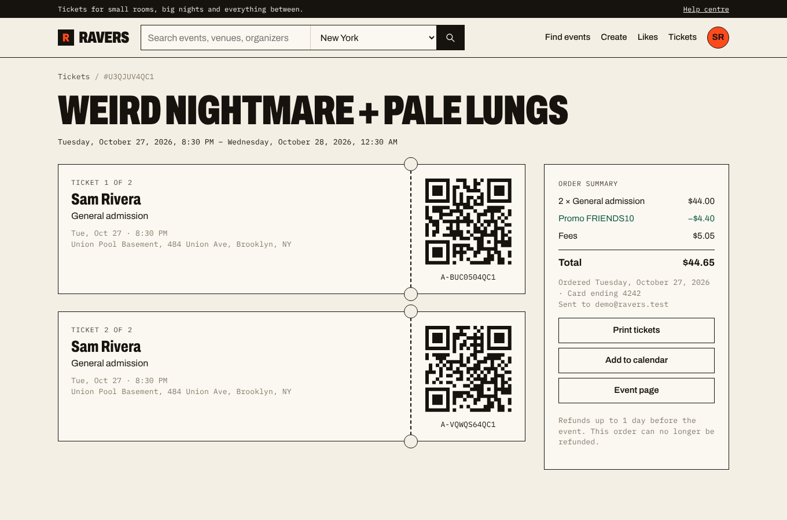

# Ravers

An event discovery and ticketing web app: browse what's on, buy tickets, and run your own events.

All data lives in the browser (localStorage), so it runs with no backend. No real payments are taken.



## Features

**Attendees**
- Home feed by city with quick filters (for you, today, this weekend, free, online, categories)
- Search with filters for location, date (presets or a specific day), category, price and format, plus sorting
- Event pages: date/time, venue with map link, refund policy, agenda, tags, add-to-calendar (.ics / Google), share
- Checkout: ticket tiers with quantity limits, promo codes, 15-minute ticket hold, attendee names, card form (demo)
- Tickets with QR codes, printing, and refunds within the organizer's refund window
- Likes, following organizers, organizer profile pages
- Account settings with home city and interests

**Organizers**
- Create/edit events: cover (generated poster or uploaded image), venue or online, schedule, description, agenda, age limit, refund policy
- Multiple free/paid ticket types with quantities, per-order limits and sales end dates; promo codes with usage limits
- Draft / publish / unpublish / cancel / duplicate / delete
- Event dashboard: sales stats, ticket-type capacity, orders (refunds, CSV export), attendee check-in (search, CSV export)
- Editable organizer profile

## Screenshots

| Event page | Checkout | Tickets |
|---|---|---|
|  |  |  |

## Run it

```bash
npm install
npm run dev       # http://localhost:5173
npm run build     # production build in dist/
```

Demo login: `demo@ravers.test` / `demo1234`. Promo code `FRIENDS10` works on events that have one (e.g. "Weird Nightmare + Pale Lungs").

When deploying, route all paths to `index.html` (the app uses client-side routing). `public/_redirects` handles this on Netlify and `vercel.json` on Vercel.
